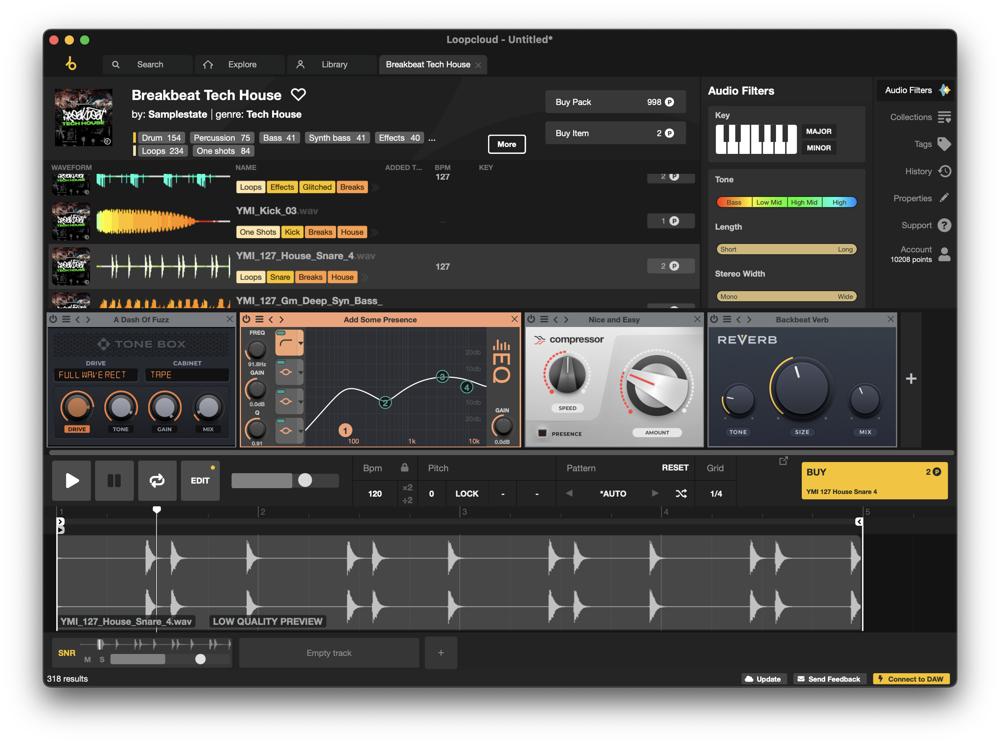
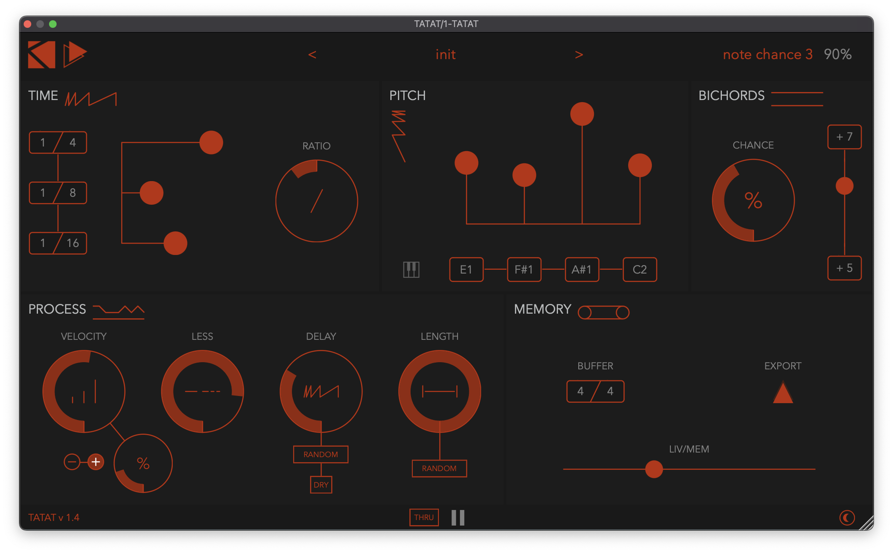
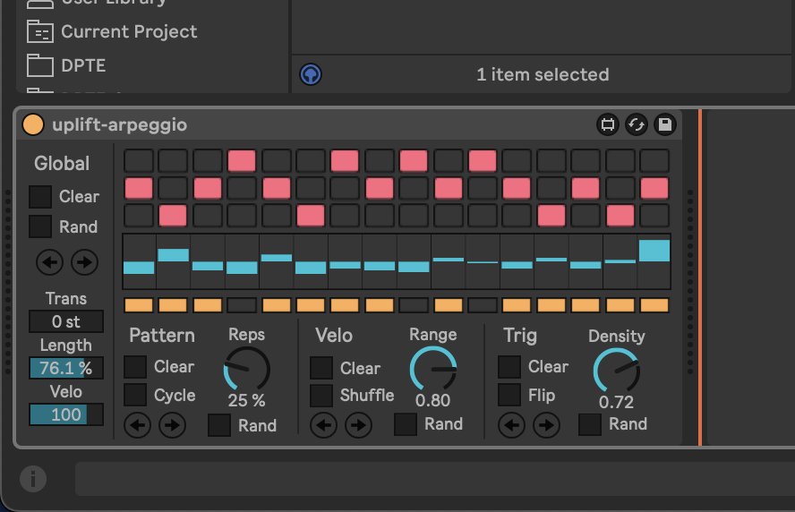
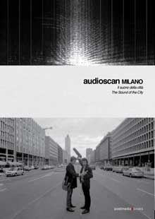
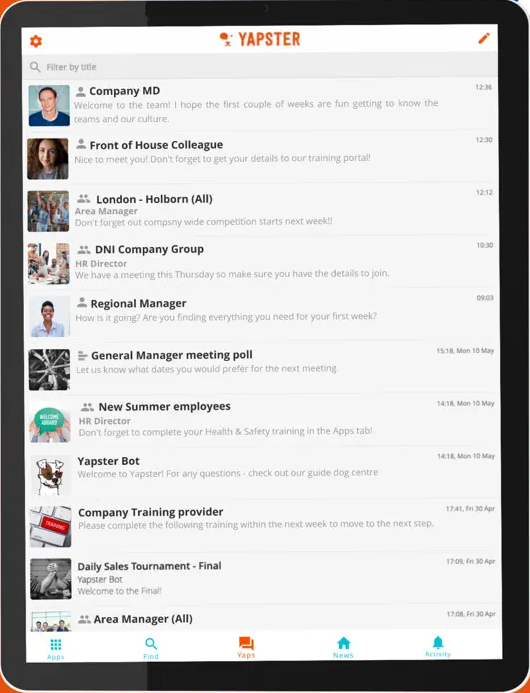
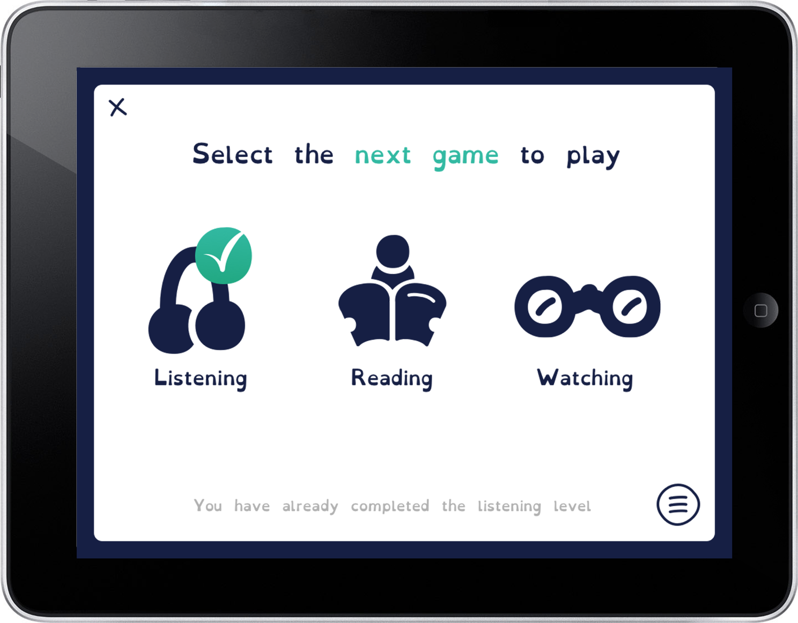
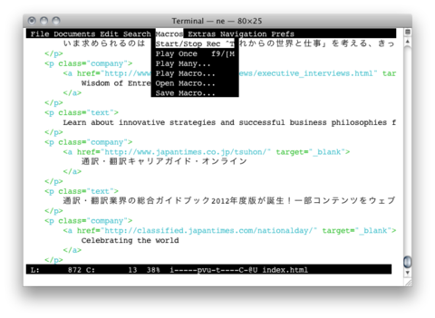

# 👋 About 

Over the last decade I've worked across compiler engineering, audio/music software, functional programming and blockchain; today I work on building static analysis tools for Solidity smart contracts using C++ and MLIR.  

I have a PhD in Computer Science from Imperial College London, where I focused on programming languages and formal methods (mostly static analysis and abstract interpretation).   

I've worked remotely for most of my career and am comfortable collaborating in distributed, async-first teams across time zones.  

Outside of software, I'm an electronic music producer and artist.

For more details, please also see my [LinkedIn](https://www.linkedin.com/in/danfilaretti/) profile or download my [CV](assets/Daniele-Filaretti-CV-2026.pdf).

# 🧑‍💻 Stuff I'm working on

I'm currently employed as a Senior R&D Engineer at [Veridise](https://veridise.com/) where I develop static analysis tools for Solidity smart contracts using C++ & MLIR. 

# 📚 Stuff I'm learning

Lately I've been working a lot with LLM tools and trying to understand their effectiveness and limitations 
in the context of the specific projects I'm involved. 

# ❤️ Selected past projects

Here's a selection of cool project I did work on in the past. 
For a more complete list plese see my [LinkedIn](https://www.linkedin.com/in/danfilaretti/) and repos on GitHub. 

 🎧 Music technology 

 
### Loopcloud

<em>Developer 2020-2024</em>

Since 2020, I contributed to the development of the Loopcloud desktop app and its companion audio plugin 
(which syncs the app to the user's DAW for a more integrated experience).

I delivered several new major features (such as <em>collections</em>, MIDI support and an onboarding interactive tutorial), 
and an extensive UI rework, in addition to countless bug fixes and workflow improvements.

    

### TATAT

<em>Lead developer 2021-2022</em>

[TATAT](https://k-devices.com/products/tatat/) is a MIDI plugin designed for 3 main purposes: to 
create always-changing sequences, to quickly sketch and store music ideas, to add unexpected 
events to fixed patterns.

      

### df.arp

<em>Author 2020-Present</em>

A Max4Live device I built for helping me quickly come up with lead 
patterns when writing trance. It started as a 2020 lockdown project 
but it's still receiving updates! 

Available [here](https://dfmusic.gumroad.com/l/df-arp)!

  

### Audioscan MILAN - Noise Transformed into Ambient Music

<em>Field recording, sound analysis/design/editing 2009-2010</em>

Since 2020, I contributed to the development of the Loopcloud desktop app and its companion audio plugin 
(which syncs the app to the user's DAW for a more integrated experience).

I delivered several new major features (such as <em>collections</em>, MIDI support and an onboarding interactive tutorial), 
and an extensive UI rework, in addition to countless bug fixes and workflow improvements.

    
 

 💻 Compilers & formal methods 

### K-Framework (Haskell backend)

<em>Developer 2018</em>

According to its [official docs](https://kframework.org/index.html), 

<em>"K is a rewrite-based executable semantic framework in which programming languages, 
type systems and formal analysis tools can be defined using configurations and rules"</em>

I loved using K as the foundational framework for my [research work](https://www.doc.ic.ac.uk/~maffeis/phpsemantics/) as a PhD student,  
and I was privileged, a couple of years later, to be able to contribute 
back to its community (as well as practicing some [Haskell](https://www.haskell.org/)!)

  

### Solidity to IELE compiler

<em>Developer 2018</em>

[IELE](https://runtimeverification.com/the-iele-virtual-machine) is an improvement on the [Ethereum blockchain virtual machine](https://ethereum.org/en/developers/docs/evm/).
 It was created after the [KEVM](https://github.com/runtimeverification/evm-semantics) project demonstrated that a K formal specification of EVM could automatically generate a VM comparable in performance to hand-crafted implementations.

I helped developing the Solidity to IELE compiler.

   
 

 😎 Misc 

### Yapster

<em>Clojure Developer (full-stack) 2019 - 2020</em>

Helped developing [Yapster](https://www.yapster.info/) - a messaging app for the workplace; contributing new features across both frontend and backend as well as bug-fixes (Clojure/ClojureScript).

I <em> really </em> enjoyed learning and working with the [Clojure](https://clojure.org/) 
programming language! 

   

### DIMMAND

<em>Lead Developer 2016 - 2017</em>

Lead the development of [DIMMAND](https://www.festoon.studio/dimmand), a cross-platform 
digital solution for detecting literacy difficulties 
& strengths in children.

  

### ne - the nice editor

<em>Internship 2009 - 2008</em>

Implemented syntax highlighting in the ne text editor. 

  
 

 🧸 Toy projects 

